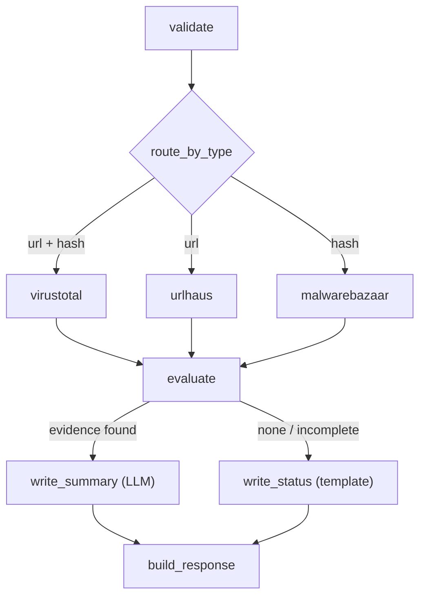

# IOC Enrichment Assistant — Project Spec

A Python API that takes one suspicious **URL** or **file hash**, queries two threat-intelligence sources **in parallel**, and returns a short, evidence-grounded analyst report.

The project demonstrates three LangGraph patterns in one workflow: **sequential** steps, **parallel** fan-out/fan-in, and **conditional routing**.

## Quick start

Requires Python 3.11+ and [uv](https://docs.astral.sh/uv/) (or plain `pip install -r requirements.txt`).

```bash
uv sync                                   # install app + dev tools
cp .env.example .env                      # optional; defaults run offline on fixtures
uv run uvicorn app.main:app --reload      # http://localhost:8000/docs
```

```bash
curl -X POST localhost:8000/analyze -H "content-type: application/json" \
  -d '{"type": "url", "value": "https://malware.example.com/payload.exe"}'
```

Checks:

```bash
uv run pytest          # 11 focused tests, no network or keys needed
uv run ruff check . && uv run ruff format --check .
uv run mypy            # strict
```

To enable LLM summaries, install a provider extra (`uv sync --extra openai`, `--extra openrouter`, or `--extra anthropic`), set `LLM_PROVIDER` / `LLM_MODEL` and that provider's API key in `.env`. To use real threat-intel APIs, set `PROVIDER_MODE=live` with `VIRUSTOTAL_API_KEY` and `ABUSECH_AUTH_KEY`.

### Fixture scenarios

Fixtures are synthetic and use reserved `example.*` domains and EICAR test-file hashes.

| Type | Value | Outcome |
|---|---|---|
| url | `https://malware.example.com/payload.exe` | `malicious_record_found` |
| url | `https://phish.example.net/login?session=42` | `flagged_by_engines` |
| url | `https://clean.example.org/` | `no_malicious_evidence_found` |
| url | `https://slow.example.com/` (VirusTotal times out) | `inconclusive` |
| hash | `44d88612fea8a8f36de82e1278abb02f` (EICAR MD5) | `malicious_record_found` |
| hash | `3395856ce81f2b7382dee72602f798b642f14140` (VirusTotal rate-limited) | `malicious_record_found` |
| hash | `d41d8cd98f00b204e9800998ecf8427e` | `no_malicious_evidence_found` |
| hash | `e3b0c44298fc1c149afbf4c8996fb92427ae41e4649b934ca495991b7852b855` (VirusTotal times out) | `inconclusive` |

Any other value returns each provider's normal "not found" response.

## 1. Goals and non-goals

**Goals**
- Enrich a single indicator (URL or hash) against two independent sources per request.
- Run both lookups concurrently and always join, even when one fails or times out.
- Produce a deterministic outcome plus a short LLM-written summary grounded in structured evidence.
- Run end-to-end without API keys using local fixtures.

**Non-goals**
- Bulk or batch indicator submission.
- Submitting URLs or files to providers for new scans; only existing records are retrieved.
- Fetching, visiting, or downloading the submitted URL. The indicator is treated as data only.
- Persistence, authentication, or a UI beyond FastAPI's `/docs`.

## 2. Tech stack

| Concern | Choice |
|---|---|
| API | FastAPI |
| Validation / schemas | Pydantic v2 |
| Orchestration | LangGraph (`StateGraph`) |
| LLM call | LangChain chat model, selected by configuration (`init_chat_model`) |
| HTTP clients | `httpx.AsyncClient` |
| Config | `pydantic-settings` + `.env` |
| Tests | `pytest`, `pytest-asyncio` |

## 3. API contract

### `POST /analyze`

**Request**

```json
{ "type": "url", "value": "https://example.org/sample?id=1" }
```

```json
{ "type": "hash", "value": "44D88612FEA8A8F36DE82E1278ABB02F" }
```

**Validation** (fails with `422` before any lookup runs)

| Type | Rule |
|---|---|
| `url` | Scheme must be `http` or `https`; host required. Preserve path and query string exactly for exact-match lookups. |
| `hash` | Hex only; length 32 (MD5), 40 (SHA-1), or 64 (SHA-256). Normalise to lowercase and record the detected algorithm. |

**Response** (`200`)

```json
{
  "indicator": { "type": "hash", "value": "3395856ce81f2b7382dee72602f798b642f14140", "hash_type": "sha1" },
  "outcome": "malicious_record_found",
  "evidence": [
    {
      "provider": "virustotal",
      "lookup_status": "rate_limited",
      "findings": {},
      "detail": "Provider rate limit hit"
    },
    {
      "provider": "malwarebazaar",
      "lookup_status": "found",
      "findings": { "signature": "EICAR-Test-File", "file_type": "com", "tags": ["eicar", "test"], "first_seen": "2026-10-30 08:00:00", "sha256": "275a021b…fd0f" },
      "detail": null
    }
  ],
  "limitations": ["VirusTotal lookup was rate-limited (Provider rate limit hit); its evidence is unavailable."],
  "summary": "MalwareBazaar (EICAR-Test-File) returned a matching malware record for this SHA-1 hash. VirusTotal was rate-limited, so cross-source confirmation is unavailable.",
  "summary_source": "template"
}
```

- `lookup_status`: `found` | `not_found` | `timeout` | `rate_limited` | `error`
- `summary_source`: `llm` | `template` (template is used when the model call fails or is disabled)

## 4. Threat-intelligence sources

| Indicator | Lookup A | Lookup B |
|---|---|---|
| URL | VirusTotal — existing URL report | URLhaus — exact URL lookup |
| Hash | VirusTotal — existing file report | MalwareBazaar — metadata lookup by hash |

- One VirusTotal adapter serves both indicator types.
- URLhaus and MalwareBazaar (abuse.ch) require an `Auth-Key` header.
- Each adapter exposes the same async interface and returns a normalised `Evidence` object; it never raises out of the node. HTTP 404 / "no results" maps to `not_found`, 429 to `rate_limited`, client timeouts to `timeout`, anything else to `error`.
- **Fixture mode is the default.** It swaps the HTTP transport (`FixtureTransport`) rather than the adapters, so the real request-building and parsing code runs offline. Fixtures are keyed by indicator value and can simulate timeouts and rate limits.

## 5. LangGraph workflow



### State

```python
class GraphState(TypedDict):
    indicator: Indicator
    evidence: Annotated[list[Evidence], operator.add]  # reducer: parallel branches append
    outcome: Outcome | None
    limitations: list[str]
    summary: str | None
    summary_source: Literal["llm", "template"] | None
```

### Patterns

- **Sequential:** `validate → enrich → evaluate → summarise → build_response`.
- **Parallel:** The router returns two node names, so LangGraph runs both provider nodes in the same superstep. A single `virustotal` node serves both indicator types. Each branch appends its own `Evidence` via the list reducer. `evaluate` runs only after both branches complete, including when one returns `timeout` or `error`. Each provider call has its own timeout (default 10 s).
- **Conditional routing:**
  1. `route_by_type` picks the provider pair from `indicator.type`.
  2. After `evaluate`, the outcome selects LLM summary vs. template status message.
- **LangChain:** Exactly one model call, in `write_summary`, using structured evidence as input. Python, not the model, decides `outcome`. If the call fails, fall back to the template and set `summary_source = "template"`.

## 6. Outcome rules

Provider **lookup status** is kept separate from the **overall outcome**. A VirusTotal report with zero malicious detections (`found`, 0 detections) is different from VirusTotal having no record (`not_found`).

Rules are evaluated in order; the first match wins.

| Outcome | Rule |
|---|---|
| `malicious_record_found` | URLhaus or MalwareBazaar returns a matching malware record. Note any gaps in the other lookup under `limitations`. |
| `flagged_by_engines` | VirusTotal reports ≥ 1 malicious engine detection and the second source returned no matching record. Include engine counts. |
| `inconclusive` | No positive evidence and at least one lookup was `timeout`, `rate_limited`, or `error`. |
| `no_malicious_evidence_found` | Both lookups completed (`found` or `not_found`) and neither returned positive evidence. State which sources were checked. |

**Evidence findings** include, when available: engine counts (malicious / suspicious / harmless / undetected), malware family or signature, tags, threat type, and the provider's analysis or first-seen date.

**Summary** is 2–3 sentences, references only fields present in `evidence`, and never upgrades or downgrades the computed outcome.

## 7. Configuration

`.env.example`

```dotenv
# fixtures | live
PROVIDER_MODE=fixtures

VIRUSTOTAL_API_KEY=
ABUSECH_AUTH_KEY=

PROVIDER_TIMEOUT_SECONDS=10

# LangChain init_chat_model identifiers; leave blank to always use the template
LLM_MODEL=
LLM_PROVIDER=
LLM_TIMEOUT_SECONDS=20

LOG_LEVEL=INFO
```

In live mode, a missing key for a provider returns that provider's evidence as `error` ("API key not configured") with a limitation message rather than failing the request. A chat model that cannot be initialised (missing package or key) is logged and summaries fall back to templates; `GET /health` reports `provider_mode` and `llm_enabled`.

## 8. Project layout

```
.
├── app/
│   ├── main.py          # FastAPI app factory, lifespan, POST /analyze, GET /health
│   ├── schemas.py       # Pydantic request/response, Indicator, Evidence, Outcome
│   ├── workflow.py      # LangGraph state, nodes, edges, compiled graph
│   ├── report.py        # outcome rules, template summaries, LLM prompt
│   ├── llm.py           # init_chat_model wiring (None when disabled)
│   ├── config.py        # pydantic-settings
│   └── providers/
│       ├── __init__.py  # ProviderSet, shared httpx client, factory
│       ├── base.py      # Provider protocol + failure-to-status mapping
│       ├── virustotal.py
│       ├── urlhaus.py
│       ├── malwarebazaar.py
│       ├── fixtures.py  # FixtureTransport (offline mode)
│       └── fixtures/    # JSON fixtures per provider
├── tests/               # schemas, rules, providers, workflow, API
├── pyproject.toml       # deps, ruff, mypy, pytest config
├── uv.lock
├── requirements.txt     # exported from uv.lock
├── .env.example
└── README.md
```

## 9. Milestones and acceptance criteria

| # | Milestone | Done when |
|---|---|---|
| 1 | **Sequential** | `POST /analyze` validates input, calls one fixture VirusTotal lookup, returns a report. One URL and one hash verified via `/docs`. Invalid inputs return `422`. |
| 2 | **Parallel + routing** | URLhaus and MalwareBazaar fixtures added. Tests prove each type calls exactly its two providers, both run concurrently, and a timeout in one preserves the other's evidence. |
| 3 | **Report writing** | LLM summary and template fallback in place. Tests cover all four outcomes: malware record, engine-only flag, clean completed check, incomplete check. Model failure yields `summary_source = "template"`. |
| 4 | **Live lookups** | Real clients added one provider at a time behind `PROVIDER_MODE`. Fixtures remain the default; the full suite passes without keys. |

### Demo scenarios

1. URL with a URLhaus malware record → `malicious_record_found`.
2. Hash where VirusTotal times out and MalwareBazaar returns nothing → `inconclusive`.

